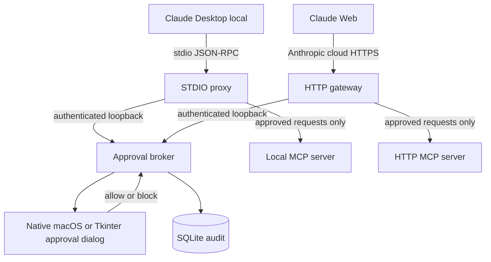
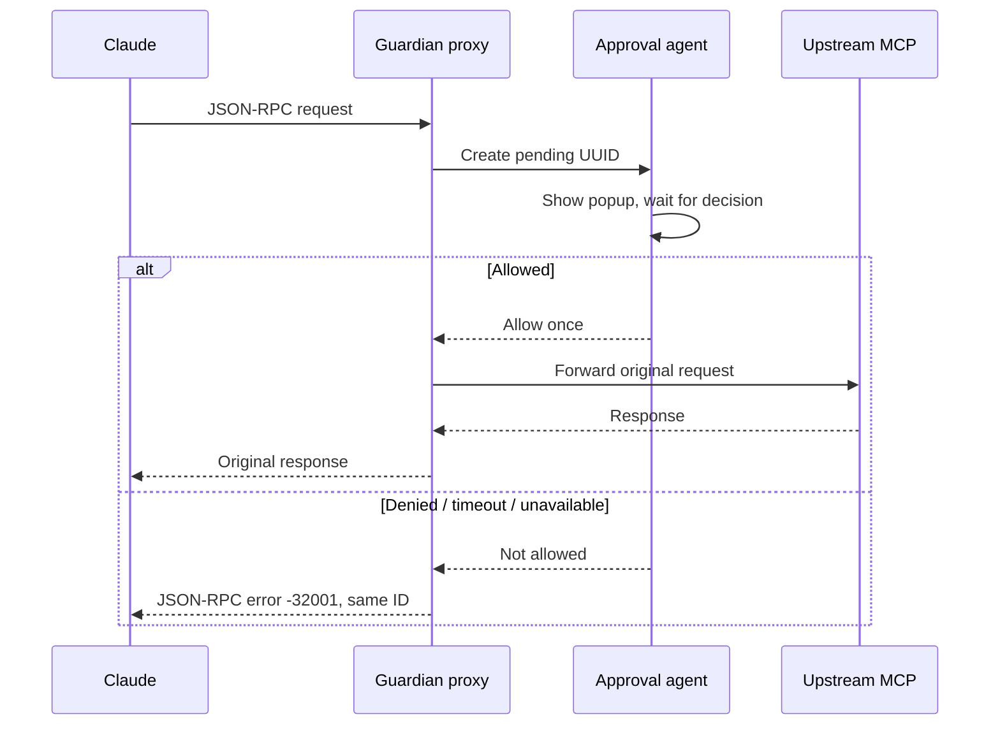

# MCP Guardian — Human-in-the-Loop MCP Firewall

 

A Python human-in-the-loop firewall for **configured** Model Context Protocol (MCP) servers used by Claude Desktop and Claude Web. It holds a JSON-RPC request before forwarding, shows a native foreground permission dialog (Tkinter topmost mode is also available), then forwards once or returns a denial. The desktop approval agent is shared by both transports.

> Interview project / single-user prototype. No injected browser scripts, packet sniffing, TLS interception or Claude modifications. Automated tests use real local transports but do not launch Claude. Live verification is tracked separately below. The application does not intercept unconfigured tools, built-in Claude tools, or other clients that bypass the gateway.

**[Demonstration video — v1.0.0](https://github.com/AbhishekAgrahari22/mcp-guardian/releases/tag/v1.0.0)**

## Objective and requirements

AI clients can invoke external tools that read data or cause side effects. MCP Guardian inserts an explicit human authorization step at the configured MCP transport boundary, before any protected request reaches its upstream server. It is designed to satisfy the following interview requirements:

| Requirement | Implementation |
|---|---|
| Monitor outgoing Claude Desktop MCP requests | STDIO subprocess wrapper; JSON-RPC request inspection |
| Monitor outgoing Claude Web MCP requests | Authenticated Streamable HTTP gateway; public HTTPS connector |
| Capture server, tool and parameters | Parse each protected request and show source, server, method, tool, ID and parameters in the dialog |
| User confirmation above active applications | Native macOS dialog; alternate Tkinter topmost window; subject to OS focus restrictions |
| Allow or Block each individual request | Unique approval ID, one-time decision and strict policy for every client JSON-RPC request |
| Keep request pending | Broker holds a decision until approval, cancellation or deadline; no upstream execution beforehand |
| Allow and denial handling | Forward original approved request; otherwise return JSON-RPC error `-32001` with original ID |
| Concurrent requests | Bounded queue, independent IDs and deadlines; dialogs shown one at a time |
| Reliability | Background approval process, timeout, disconnect and shutdown handling; fail closed |
| Security | Loopback-only broker, separate authentication keys, fixed upstream, input validation, minimal audit logging |
| Maintainability | Modular Python package, tests, CI, setup documentation and demo checklist |

### Verification status

| Verification | Status |
|---|---|
| Automated test suite on macOS | 12 passed (9.01s, 20 November 2026) |
| Native macOS dialog, manual Allow and Block | Verified; `Approved: True` and `Approved: False` |
| Claude Desktop discovery and Allow | Verified on macOS: successful create_file call; terminal confirmed `interview.txt` contains `Hello MCP Guardian` |
| Live Claude Desktop Block | Verified: deletion denied and original file preserved |
| Local HTTP gateway and concurrency | Covered by automated tests; interactive demo instructions below |
| Live Claude Web Allow and Block | Verified: approved tool execution succeeds and blocked deletion leaves the file unchanged |
| Recorded demonstration | Published on GitHub Releases, v1.0.0 (`mcp-guardian-demo.mov`, 8.12 MB) |

Live verification results are reported by the project operator. Claude Desktop and Claude Web Allow and Block checks are complete. Automated tests provide additional coverage independently of the live client checks.

## Demonstration video

[View demonstration release](https://github.com/AbhishekAgrahari22/mcp-guardian/releases/tag/v1.0.0) | [Download demonstration video (.mov)](https://github.com/AbhishekAgrahari22/mcp-guardian/releases/download/v1.0.0/mcp-guardian-demo.mov)

The recording is attached to release **v1.0.0** under Assets. See [the demonstration guide](docs/DEMO.md) for reproducible test steps. The published recording accompanies the completed live verification. The steps below allow reviewers to reproduce the tests.

## Quick start (macOS / Windows)

Requirements: Python **3.11+**, a graphical desktop (native AppleScript dialogs on macOS by default; Tkinter on Windows/Linux), and Claude Desktop for the first demo. For Claude Web additionally install [ngrok](https://ngrok.com/download) and create a free ngrok account (or use another HTTPS tunnel). A public URL alone is not enough: configure the secret header as described below.

1. Clone the repository and open the project directory in VS Code (or download the source ZIP from the release).

```bash
git clone https://github.com/AbhishekAgrahari22/mcp-guardian.git
cd mcp-guardian
```
2. Create and activate a virtual environment.

macOS / Linux:

```bash
python3 -m venv .venv
source .venv/bin/activate
python -m pip install -r requirements-dev.txt
```

Windows PowerShell:

```powershell
py -3 -m venv .venv
.venv\Scripts\Activate.ps1
python -m pip install -r requirements-dev.txt
python -m tkinter
```

If PowerShell activation is blocked, use `.\.venv\Scripts\python.exe` instead of `python` in each command, or use Command Prompt and `.venv\Scripts\activate.bat`. Close the small Tk test window. On Linux, install `python3-tk` if necessary; on macOS, use a Python installer with Tk support (python.org). Native topmost behavior depends on the OS/window manager.

3. Generate local credentials (only once), then start the approval agent:

```bash
python main.py setup
python -u main.py agent
```

Keep this process running. On macOS the default agent is a terminal background process that opens native AppleScript dialogs when requests arrive; there is no idle GUI window. Use `python main.py agent --ui tk` for the alternate Tkinter UI (required for long request details). On Windows/Linux the default is the Tkinter UI. Native dialog foreground behavior must be verified on your own Mac; use a regular desktop Space instead of full-screen mode. No automatic permission or remembered grants exist.

In a second activated terminal, run `python main.py approval-test`. Click **Allow once** and verify `Approved: True`, then run again and click **Block** to verify `Approved: False`. This checks the approval mechanism without connecting Claude or executing a tool. Do not continue to Claude until both work. Agent logs show the approval UUID and state, without request arguments. macOS dialogs use a private temporary file for display details; the file is removed after review, although an abrupt process kill could leave a private file behind. Requests too large for the native dialog are denied; switch to `--ui tk` to inspect them.

Generated configuration: `.guardian/config.json` (not committed). Default timeout: 45 seconds. Default maximum pending requests: 32. `GUARDIAN_HOME` optionally overrides the state directory; use the same value in every process. Audit: `.guardian/audit.sqlite3`. Demo files: `.guardian/demo-files/`. To adjust timeout or pending limit, stop all components, edit config, restart. Do not edit or share keys while running.

## A. Claude Desktop (local STDIO)

In a second terminal (same environment):

```bash
python main.py desktop-config
```

On macOS and Windows, fully quit Claude first, then run `python main.py desktop-install` to automatically merge the demo entry with a private backup of existing settings. Use `python main.py desktop-remove` to remove only this entry later.

The desktop-config command prints the complete JSON with absolute paths to your current Python interpreter and `main.py`. No manual file-path editing is required.

1. In Claude Desktop, open Settings → Desktop app → Extensions → Local MCP servers → Edit config (older versions: Developer → Edit Config) (local MCP settings; availability may depend on organizational policy). The usual configuration paths are:
   - macOS: `~/Library/Application Support/Claude/claude_desktop_config.json`
   - Windows: `%APPDATA%\Claude\claude_desktop_config.json`
2. Back up your config. Merge the generated `guardian-demo` entry into the existing `mcpServers` object; do not overwrite unrelated entries. To protect an existing server, replace its original entry with a wrapped one (do not retain the unprotected duplicate).
3. Fully quit Claude Desktop (Cmd+Q on macOS; quit from tray on Windows), restart, and check the `guardian-demo` tools.
4. In a fresh Claude chat, enable the local `guardian-demo` tools. Ask: **Use the guardian-demo create_file tool to create desktop-demo.txt containing "Hello MCP Guardian". Do not retry if denied.** Use a fresh filename if it already exists. If Claude's own permission prompt appears, grant it for this demo operation to see Guardian's independent confirmation. Click **Allow once** in Guardian. Verify actual execution:

   ```bash
   cat .guardian/demo-files/desktop-demo.txt
   ```

   Expected: `Hello MCP Guardian`.

5. Ask: **Use the guardian-demo delete_file tool to delete desktop-demo.txt. Do not retry if blocked.** Click **Block** in Guardian. Run the same `cat` command; the original content must remain. Verify a `block` decision in the audit history. If Claude retries or uses another protected tool, each routed call receives its own approval. A successful deletion is not evidence of blocking.

The generated Desktop config uses `--policy actions` for discovery compatibility. Change `actions` to `strict` to request approval for **all client-originated JSON-RPC requests**, including initialize and tools/list; keep the agent visible during connection and approve discovery promptly. Strict is the CLI default; the actions policy is an explicit demo choice because clients can time out during discovery. Both modes always protect tool calls, resource reads, prompt retrieval and unknown request methods.

For the literal requirement to approve every individual request, use `strict`. On Desktop, after `desktop-install`, open the config, change the single `--policy` argument value from `actions` to `strict`, and restart Claude with the agent already running. On the web gateway replace `--policy actions` with `--policy strict`. Approve initialization and discovery separately. Strict mode may require reconnecting if a client times out during discovery. Re-running `desktop-install` restores the demo's `actions` policy. The supplied video quick start uses `actions` for a smoother demonstration; show `strict` separately if evaluating every request.

To wrap a different STDIO MCP server:

```bash
python main.py stdio --name filesystem --policy strict -- npx -y @modelcontextprotocol/server-filesystem /absolute/allowed/folder
```

Use the same argument ordering in Claude's config: the original executable and arguments go **after `--`**. Do not put shell syntax there; the subprocess is launched without a shell. Preserve required `env` variables in the Claude config; specify absolute executables where necessary. An actual server may require Node, uv, etc. Only wrap trusted servers. Logs go to stderr, never protocol stdout.

## B. Claude Web (remote Streamable HTTP)

Start the agent from Quick start first, then in separate activated terminals:

```bash
# Terminal 2: private upstream demo MCP server
python main.py demo-http --port 9001
```

```bash
# Terminal 3: authenticated gateway
python main.py http --port 8000 --upstream http://127.0.0.1:9001/mcp --name web-demo --policy actions
```

```bash
# Terminal 4: expose ONLY port 8000, never the broker (8765) or upstream (9001)
ngrok config add-authtoken YOUR_NGROK_TOKEN
ngrok http 8000
```

Copy the public HTTPS forwarding URL displayed by ngrok and append `/mcp`. Do not include an explicit nonstandard port. From another activated terminal, obtain the generated connector secret:

```bash
python main.py web-key
```

1. In Claude Web go to **Customize → Connectors → Add → Custom → Web** (some versions label this Add custom connector) (organization accounts may need an admin). Name it `Guardian Web Demo`.
2. Paste `https://YOUR-NGROK-HOST/mcp` and continue.
3. Select **No sign in** for OAuth authentication, then under **Request headers** add `X-Guardian-Key` with the exact output of `python main.py web-key`. This is the actual API-key authentication; do not omit it. If the account UI lacks custom request headers, do not disable authentication. Use a permitted account/UI or add an OAuth implementation before exposing it.
4. Click Add / Connect and enable **Guardian Web Demo** in a fresh browser conversation. Avoid selecting the local Desktop connector for this test. Ask: **Use the Guardian Web Demo create_file tool to create web-demo.txt containing "Hello from Claude Web". Do not retry if denied.** Click Allow once, then run `cat .guardian/demo-files/web-demo.txt`. Ask: **Use the Guardian Web Demo delete_file tool to delete web-demo.txt. Do not retry if blocked.** Click Block and run the same `cat` command. Both the file and the audit entries labelled `Claude Web / HTTP` must confirm the result. Free Claude accounts may be limited to one remote custom connector; use a plan/account with permission to add this connector.
5. Stop the tunnel after recording; remove the connector or update its URL if the tunnel changes. Never show your secret on the recording.

Claude's cloud connects to remote MCP endpoints, not the local browser. The HTTPS tunnel delivers these calls to the locally running approval agent. The upstream stays loopback-only. Read [Claude custom connector setup and header authentication](https://support.claude.com/en/articles/11175166-get-started-with-custom-connectors-using-remote-mcp).

For other HTTP MCP servers, set `--upstream` to the exact fixed MCP endpoint. If it needs a static bearer token, set `GUARDIAN_UPSTREAM_BEARER` in the gateway environment. Client credentials are not forwarded. Upstream OAuth flows and legacy separate `/sse` + `/messages` transport are not implemented. Never forward arbitrary URLs supplied by clients. Use trusted upstreams only.

## C. Test without Claude (optional manual UI check)

Start the agent, the private demo HTTP server and the HTTP gateway on the default ports as above. No public tunnel needed. Run:

```bash
python manual_demo.py
```

This sends initialization, discovery, two concurrent create requests, then prints whether each file actually exists. Approve the first displayed request and block the other (order may vary; review filenames). To demonstrate a deletion, use Claude or run `python manual_demo.py --delete`. The local script uses generated secrets without printing them.

## Architecture





| Module | Responsibility |
|---|---|
| `main.py` | CLI entry point, generated Desktop config |
| `guardian/protocol.py` | Strict JSON parsing, typed IDs, authorization policy |
| `guardian/stdio.py` | Bidirectional local JSON-RPC relay, worker pool, cancellation |
| `guardian/http_gateway.py` | Authenticated Streamable HTTP reverse proxy, response streaming |
| `guardian/broker.py` | Independent approval UUIDs, bounded queue, one-time decisions, audit |
| `guardian/approval.py` | Sync/async authenticated loopback clients, deadline handling |
| `guardian/ui.py` | Tk event loop, FIFO topmost window, countdown, close-to-block |
| `guardian/mac_ui.py` | macOS native approval dialogs, timeout/cancellation, fail-closed |
| `guardian/desktop_config.py` | Merge or remove demo configuration with backup |
| `guardian/demo.py` | Independent demo upstream, restricted text-file operations |
| `manual_demo.py` | Real local HTTP requests to verify popup without Claude |
| `tests/` | Real transport integration tests, no GUI required |

### Policy and protocol choices

- Strict mode gates every client-originated JSON-RPC request with an ID. Actions mode skips known initialization and discovery calls to avoid breaking client startup. Unknown request methods are gated in both modes.
- Protocol responses and known notifications are forwarded without popups; cancellation of a held request cancels the approval without contacting upstream. Unknown client notifications are dropped/rejected. HTTP GET and DELETE are transport controls; they are relayed without tool approval. A session DELETE cancels associated pending approvals.
- Each approval has a UUID distinct from the JSON-RPC ID. Pending STDIO IDs are scoped to a proxy connection; HTTP IDs are scoped to session ID (or the single stateless connector). The broker handles simultaneous clients with independent state. One native popup at a time avoids overlapping dialogs; queued requests still have independent expiration times.
- Approval is fail-closed: timeout, popup close, broker unavailable, audit failure, cancelled/disconnected HTTP request or agent termination does not approve a still-pending operation. Already-forwarded operations cannot be revoked. There are no automatic retries or auto-allow decisions. Denials use JSON-RPC server error `-32001` with the original ID.
- The gateway relays the HTTP status, relevant MCP headers, and response bytes including SSE. It does not attempt to rewrite or decrypt unrelated traffic. The tested protocol scope is single-message JSON-RPC and MCP 2025-03-26 / 2025-06-18 / 2025-11-25 STDIO and Streamable HTTP; the included small demo implements only tools, not resources or prompts. Newer per-request metadata or custom mirrored parameter headers, legacy batch messages, OAuth passthrough, and long-lived SSE session replay are outside validated scope. The proxy is not a complete MCP SDK or protocol conformance suite.

### Security assumptions

The operator owns the configured server and credentials. A local process with access to the same OS account or config secrets is trusted; this is not a system-wide sandbox. The approval service binds only to `127.0.0.1`, requires its private random key, and never exposes a public approve endpoint. The gateway has a separate key, validates Origin when present, limits request size and in-flight work, does not follow upstream redirects, and strips credentials/cookies. The upstream is fixed; only expose the gateway port. Requests are held in memory, with no persistent parameters in SQLite. The popup displays original request parameters (including any sensitive values), so use test data and avoid exposing the screen. Audit records contain source/server/method/decision/time, not argument values. The label identifies configured ingress, not verified Claude identity. A user sharing a key may impersonate the connector; this is a single-user demonstration, not a multi-tenant authorization system. OS focus restrictions can affect topmost windows across virtual desktops, fullscreen apps or secure OS dialogs. The demo directory is dedicated to this application; do not allow untrusted local users to mutate it concurrently.

For production: use OAuth per-user identity, a hardened service manager, per-tenant session binding, endpoint rate limits, authenticated IPC using OS permissions, protocol-SDK conformance testing, encrypted/retained audit logs, persistent idempotency for side effects, and a reliable upstream network policy preventing direct bypass. Confirm the organization's policy on every protected tool. A proxy cannot force Anthropic cloud traffic from unconfigured connectors through itself.

## Automated tests

```bash
python -m pytest -q
```

Tests run without Claude credentials or a display, using a real authenticated approval broker controlled by test code. They verify held requests have no file side effect, Allow executes, Block does not execute, simultaneous requests get their own decisions, cancellation, timeout, agent offline, strict discovery, input validation and HTTP auth/origin. The headless test decision mechanism is not available through public HTTP in production. Additional tests verify merge/removal preserves unrelated settings and simulate native dialog return codes. These simulated tests do not execute AppleScript or verify macOS window visibility. Test reports are not proof of a live Claude session.

## Audit history and troubleshooting

```bash
sqlite3 -header -column .guardian/audit.sqlite3 \
  "SELECT datetime(time,'unixepoch','localtime') AS time, source, server, method, decision FROM decisions ORDER BY time DESC LIMIT 10;"
```

- `allow` is permission to forward, not proof that the upstream operation succeeded. Verify the file or upstream response.
- `block` indicates an explicit denial or safe rejection. `timeout`, `cancelled` and `shutdown` also prevent still-pending operations from executing.
- If a dialog does not appear, run `python main.py approval-test` with the agent running. On macOS use the native default and check agent logs. Keep the desktop out of full-screen Spaces.
- If the broker reports `Address already in use`, check `lsof -nP -iTCP:8765 -sTCP:LISTEN` on macOS. Do not start a second approval agent.
- If Claude reports a generic connector error, inspect the audit decision and (on macOS) `~/Library/Logs/Claude/mcp-server-guardian-demo.log`. Error `-32001` is the expected denial code; it can also indicate timeout or broker unavailability.
- If the demo file exists already, choose a new `.txt` name. The demo intentionally does not overwrite files.
- If Web cannot connect, check the gateway, upstream, tunnel URL and request header; never turn off auth. Do not expose ports 9001 or 8765.

To stop: press Ctrl+C in the gateway, tunnel, upstream and agent terminals. Quit Claude Desktop before running `python main.py desktop-remove` to remove only the Guardian configuration. A subsequent `desktop-install` can restore it. Remove the custom Web connector after the demo if no longer needed.

## Record your video and submit

Follow [docs/DEMO.md](docs/DEMO.md). Record 4–6 minutes on macOS with **Cmd+Shift+5**. Show the terminal and Claude side by side, hide private chats and never record authentication values or `.guardian/config.json`.

Suggested sequence:

| Scene | Evidence |
|---|---|
| Introduction and architecture | Show `guardian/` modules and explain the proxy between Claude and MCP upstream |
| Desktop Allow | Create a unique demo file; show request parameters, click Allow once, verify content in terminal |
| Desktop Block | Delete the same file, click Block, show unchanged content and audit decision |
| Web Allow / Block | Use the browser with the authenticated remote connector and repeat the two operations |
| Concurrent requests | Run `python manual_demo.py` with HTTP services running; allow one and block the other |
| Reliability and testing | Show a timeout or discuss fail-closed handling; run `python -m pytest -q` and show audit history |

### Repository and release

- [Source code and documentation](https://github.com/AbhishekAgrahari22/mcp-guardian)
- [Version v1.0.0 and demonstration assets](https://github.com/AbhishekAgrahari22/mcp-guardian/releases/tag/v1.0.0)
- [Download the recorded demonstration](https://github.com/AbhishekAgrahari22/mcp-guardian/releases/download/v1.0.0/mcp-guardian-demo.mov)

The video is hosted as a GitHub release asset rather than committed into Git history. Generated local configuration (`.guardian/`), virtual environments, audit data and secrets must remain excluded from version control. To run the project, follow the Quick start above.

### Deliverables checklist

- [x] Python project uploaded to GitHub.
- [x] README covers installation, configuration, usage, architecture, security, limitations and testing.
- [x] Demonstration recording published on GitHub and linked from this README.
- [x] Automated tests passed on macOS; live Desktop Allow confirmed with filesystem evidence.
- [x] Live Desktop Block confirmed with file-preservation evidence.
- [x] Live Claude Web Allow and Block confirmed.
- [x] Repository and video access confirmed by the project operator.

## References

- [Model Context Protocol 2025-11-25 transport specification](https://modelcontextprotocol.io/specification/2025-11-25/basic/transports)
- [MCP official documentation](https://modelcontextprotocol.io/)
- [Claude Desktop local MCP setup](https://support.claude.com/en/articles/10949351-getting-started-with-local-mcp-servers-on-claude-desktop)
- [Claude remote MCP connectors](https://support.claude.com/en/articles/11175166-get-started-with-custom-connectors-using-remote-mcp)
- [GitHub: publishing local code](https://docs.github.com/en/migrations/importing-source-code/using-the-command-line-to-import-source-code/adding-locally-hosted-code-to-github)
- [GitHub: managing releases](https://docs.github.com/en/repositories/releasing-projects-on-github/managing-releases-in-a-repository)
